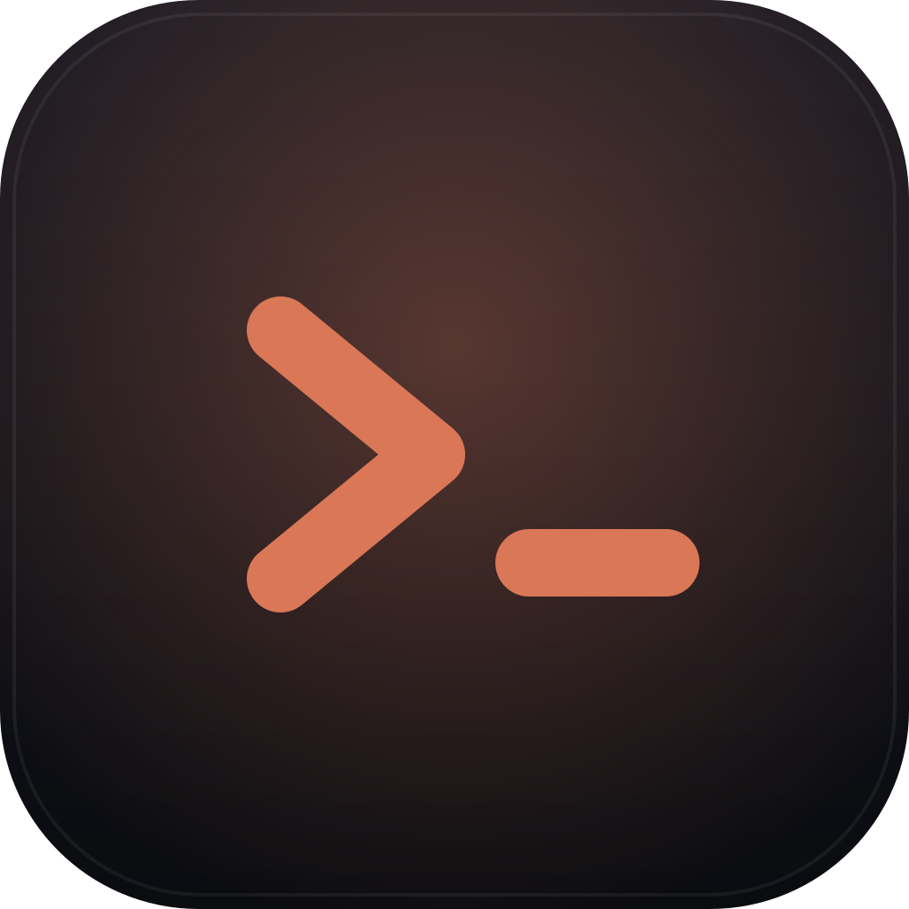

<div align="center">



# Claude Terminal Hub

**Uma janela para todas as suas sessões do Claude Code.**<br>
Retome qualquer sessão na pasta certa com um clique, em até quatro terminais de verdade lado a lado. Um app desktop para Windows.

[](https://github.com/obrenoalvim/claude-terminal-hub/releases/latest)

[](LICENSE)
[](https://github.com/obrenoalvim/claude-terminal-hub/stargazers)
[](https://github.com/obrenoalvim/claude-terminal-hub/releases/latest)
[](#arquitetura)

[English](README.md) · **Português**

[Funcionalidades](#funcionalidades) · [Início rápido](#início-rápido) · [Atalhos](#atalhos-de-teclado) · [Pré-requisitos](#pré-requisitos) · [Arquitetura](#arquitetura) · [Perguntas frequentes](#perguntas-frequentes)

</div>

---

Um app desktop que resolve o "em que pasta era essa sessão do Claude Code mesmo?" com um clique. Ele lista todas as sessões recentes do Claude Code de todos os projetos da sua máquina, num lugar só, e mantém até 4 terminais de verdade visíveis ao mesmo tempo, lado a lado. Cada um é um processo PowerShell completo, não um console fake.

Clica numa sessão na barra lateral e ela abre um painel novo já com `cd` pra pasta certa, rodando `claude --resume <session-id>`. Sem abrir o Explorer, achar a pasta certa, abrir um terminal ali e digitar `claude --resume` na mão.

## Início rápido

**[Baixar para Windows](https://github.com/obrenoalvim/claude-terminal-hub/releases/latest)**, rode o instalador, pronto. Sem `git clone`, sem `npm install`, sem build.

O instalador deixa escolher a pasta de instalação e cria atalhos na Área de Trabalho e no Menu Iniciar. Não precisa de admin.

## Funcionalidades

- **Lista de sessões entre projetos**: lê `~/.claude/projects/*.jsonl` direto, sem precisar configurar nada. Com busca, ordenado por atividade mais recente. Clicar numa sessão que já tá aberta num painel só foca ele, sem duplicar.
- **Um clique pra retomar**: abre um painel novo na pasta certa e já roda `claude --resume` pra você.
- **Até 4 painéis de terminal ao mesmo tempo**, todos visíveis juntos num grid que se reorganiza conforme você abre e fecha painéis (1, 2, 3 ou 4), nunca escondido atrás de abas. PTYs de verdade via `node-pty`, totalmente interativos: setas, `vim`, a própria TUI do Claude Code, tudo funciona normal.
- **Painéis sobrevivem a um restart do app**: o que tava aberto reabre (mesma pasta/comando) na próxima vez que você abrir o app.
- **Abrir outro terminal na pasta de um painel existente**, com um clique no cabeçalho daquele painel, pra quando você quer um segundo shell do lado de uma sessão do Claude sem caçar a pasta de novo.
- **Escolha de shell** no botão de terminal em branco: PowerShell, cmd, Git Bash ou WSL, o que tiver instalado.
- **Busca dentro do terminal** (Ctrl+F) via addon de busca do xterm: navega entre ocorrências no scrollback do painel.
- **Tema claro/escuro** e **interface em inglês/português**, ambos nas Configurações. Inglês por padrão.
- **Indicador de atividade** no dot de status de cada painel, e confirmação antes de fechar um painel com atividade recente, pra não perder um comando rodando por um clique sem querer.
- **Notificação desktop** quando um painel encerra ou toca o bell do terminal com a janela sem foco.
- **Auto-update**, checado ao abrir e a cada 4h com o app aberto.
- Janela nativa do Electron: sem aba de navegador, sem servidor pra lembrar de subir.

### Atalhos de teclado

| Atalho | Ação |
|---|---|
| Ctrl+T | Novo terminal |
| Ctrl+W | Fecha o painel focado |
| Ctrl+Tab | Cicla o foco entre painéis |
| Ctrl+F | Busca no painel focado |
| Ctrl+= / Ctrl+- / Ctrl+0 | Aumenta, diminui, reseta o zoom |

## Pré-requisitos

- Windows. O app usa PowerShell e foi construído e testado lá. Um shell Linux/macOS precisaria de `SHELL` apontando pra algo válido, e isso não foi testado.
- [Claude Code](https://claude.com/claude-code) instalado e logado, pros botões de "retomar sessão" funcionarem.
- Git Bash e/ou WSL são opcionais. Só são necessários se você escolher eles no seletor de shell. O app cai pra PowerShell se não tiverem instalados.
- [Node.js](https://nodejs.org/) 18+, só pra rodar o app a partir do código-fonte.

## Instalar e rodar a partir do código-fonte

Só quer usar o app? Usa o [link de download acima](https://github.com/obrenoalvim/claude-terminal-hub/releases/latest). Os passos abaixo são pra quem vai buildar a partir do código-fonte.

```powershell
git clone https://github.com/obrenoalvim/claude-terminal-hub.git
cd claude-terminal-hub
npm install
npm run dev
```

`npm run dev` sobe em modo desenvolvimento com hot reload. `npm run build` gera um build de produção em `out/`; `npm start` roda esse build.

### Instalador Windows

`npm run dist` builda o app e empacota num instalador Windows (NSIS `.exe`) dentro de `dist/`. O instalador deixa escolher a pasta de instalação e cria atalhos na Área de Trabalho/Menu Iniciar, sem precisar de admin (`oneClick: false`).

```powershell
npm install
npm run dist
```

O arquivo `dist/Claude Terminal Hub Setup <versão>.exe` é o que se distribui; o resto dentro de `dist/` é build intermediário.

### Publicando atualizações

O app instalado verifica os GitHub Releases atrás de uma versão nova ao abrir (`electron-updater`) e oferece reiniciar pra instalar assim que baixa. Não precisa reinstalar na mão depois da primeira vez.

Pra publicar uma release: sobe o `version` no `package.json`, depois roda `npm run release` com um [`GH_TOKEN`](https://github.com/settings/tokens) (escopo `repo`) no ambiente. `GH_TOKEN=$(gh auth token) npm run release` funciona se já tiver logado no `gh` CLI. Isso builda o instalador e sobe ele mais o metadado de atualização (`latest.yml`) numa GitHub Release nova pra tag atual. `npm run dist` (sem token) builda local sem publicar.

**Atenção:** o `electron-builder` cria a GitHub Release como **draft**. Uma release draft é invisível pro `electron-updater`, então quem já tem o app instalado não vê a atualização até ela ser publicada: `gh release edit vX.Y.Z --draft=false`.

O nome do instalador é fixo (`Claude-Terminal-Hub-Setup.exe`, sem número de versão), então o [link de download acima](https://github.com/obrenoalvim/claude-terminal-hub/releases/latest) sempre aponta pro build mais recente.

## Arquitetura

- **Processo principal** (`src/main`) é dono do trabalho de verdade. O `sessions.js` varre `~/.claude/projects` atrás de metadados de sessão, o `pty-manager.js` gerencia os processos `node-pty` (um por painel aberto, com o shell escolhido, e fallback gracioso se ele não tiver instalado), e o `index.js` liga os dois a handlers do `ipcMain`, cria a janela e conduz o check periódico do `electron-updater`. O `electron-log` também tá ligado aqui, então crash e falha de spawn do pty caem num arquivo de log em vez de sumir.
- **Preload** (`src/preload`) expõe uma superfície estreita `window.api` via `contextBridge` (listar sessões, iniciar/escrever/redimensionar/matar um painel, assinar a saída do pty, repassar erro do renderer pro log do main). Nada de Node ou internals do Electron vaza pro renderer.
- **Renderer** (`src/renderer`) é um app React pequeno: `Sidebar` (busca + lista de sessões + escolha de shell), `PaneGrid` (organiza quantos painéis estiverem abertos), `TerminalPane` (uma instância do [xterm.js](https://xtermjs.org/), mais o addon de busca, ligada a um pty via a API do preload) e `SettingsPanel` (toggles de skip-permissions, tema e idioma). Painéis abertos, tamanho de fonte, tema, idioma e estado da sidebar persistem no `localStorage` e voltam ao abrir o app. Os textos da interface ficam em `src/shared/locales` (`en.js`/`pt.js`), compartilhados entre o renderer e o processo principal (diálogos nativos de atualização) via `src/shared/i18n.js`.

O Claude Code grava uma transcrição `.jsonl` por sessão, e cada linha já carrega o diretório de trabalho (`cwd`), um título gerado por IA (`aiTitle`) e o último prompt que você mandou (`lastPrompt`). O `sessions.js` lê só os primeiros e últimos KB de cada arquivo (não a transcrição inteira) pra puxar isso rápido, ordena tudo por data de modificação, e entrega pro renderer como JSON.

## Limitações

- Máximo de 4 painéis por design, pra manter o layout legível.
- Fechar um painel mata o shell dele. Painéis com atividade recente pedem confirmação antes, os ociosos fecham direto.
- O indicador de atividade e a confirmação de fechamento são aproximados (baseados em output recente do pty), não shell integration de verdade ("tem comando rodando de fato"). Isso precisaria de marcadores OSC133 de prompt, que nenhum shell aqui emite por padrão.
- "Abrir outro terminal aqui" só funciona em painéis abertos com um caminho conhecido (uma sessão retomada, ou um aberto a partir de outro painel). Um terminal em branco cai na pasta home e não tem o que copiar.
- Atalhos de teclado são fixos, não remapeáveis pelo usuário.

---

## Perguntas frequentes

**Como ele acha minhas sessões?**
Lê as transcrições `.jsonl` que o Claude Code grava em `~/.claude/projects`. Só lê os primeiros e últimos KB de cada arquivo, pra pegar a pasta, o título e seu último prompt.

**Funciona no macOS ou Linux?**
Foi construído e testado no Windows. Veja [Pré-requisitos](#pré-requisitos).

**Por que só quatro painéis?**
Por design, pra manter o layout legível.

**O que acontece com um comando rodando quando fecho um painel?**
Fechar um painel mata o shell dele. Painéis com saída recente pedem confirmação antes.

## Mais do mesmo autor

- [**claude-code-wrapped**](https://github.com/obrenoalvim/claude-code-wrapped): transforma seu histórico de sessões num poster compartilhável.
- [**claude-usage-tray**](https://github.com/obrenoalvim/claude-usage-tray): ícone na bandeja do Windows com o uso de 5 horas do Claude Code.
- [**zero-drift**](https://github.com/obrenoalvim/zero-drift): skill que mantém sessões longas ancoradas.

## Contribuindo

Bug, ideia ou um shell que deveria estar no seletor? Abra uma issue ou um PR. Veja o [CONTRIBUTING.pt-BR.md](CONTRIBUTING.pt-BR.md) e o [changelog](CHANGELOG.md).

## Licença

[MIT](LICENSE)

---

<div align="center">

Se isso te poupou uma viagem pelo Explorer, uma ⭐ ajuda outras pessoas que usam Claude Code a encontrar o projeto.

<sub>**Tópicos:** claude-code · claude · anthropic · terminal · electron · windows · pty · xterm-js · session-manager · developer-tools · productivity</sub>

</div>
